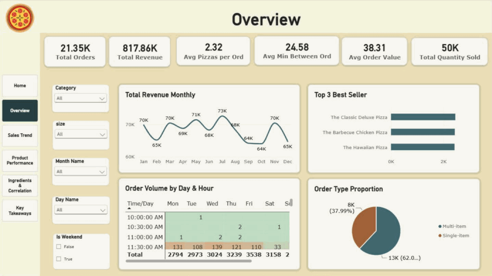
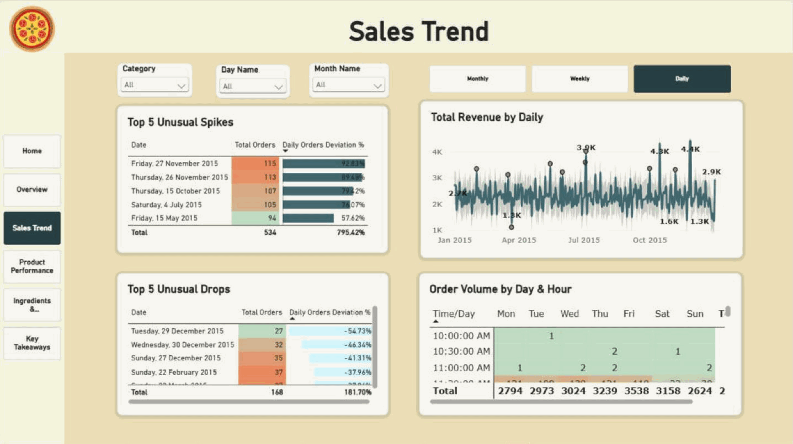
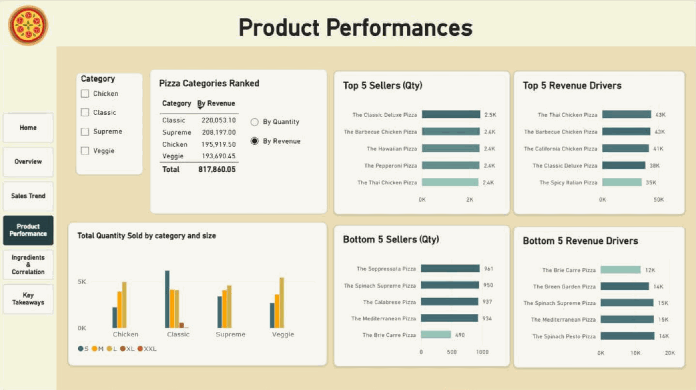
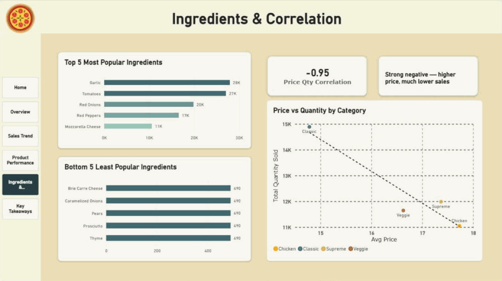

# Pizza Sales Analysis

A Power BI report on one year of orders (1 January to 31 December 2015) from a pizza company, built to a Power BI assessment brief. One flat CSV export is split into a star schema with an ingredient bridge table in Power Query and analysed with DAX to show how sales move through the year, when customers order, which pizzas carry the menu and how price relates to volume.

The requirements, KPI definitions and the data validation log are in a Word document: **[Download Requirements & Data Validation (.docx)](https://github.com/QuangMinhV/thomas-s_portfolio/raw/main/pizza-sales/Pizza_Sales_Requirements_and_Data_Validation.docx)**.

  

## Table of Contents

- [Problem Statement](#problem-statement)
- [Documentation](#documentation)
- [Data Source](#data-source)
- [Architecture](#architecture)
- [Report Features](#report-features)
- [Semantic Model](#semantic-model)
  - [Relationships](#relationships)
  - [Measures](#measures)
- [Business Insights](#business-insights)
  - [Overview](#overview)
  - [Sales Trend](#sales-trend)
  - [Product Performance](#product-performance)
  - [Ingredients and Correlation](#ingredients-and-correlation)
  - [Recommendations](#recommendations)

## Problem Statement

The project answers five questions for the company's operations managers:

1. **How do sales move through the year?** Monthly, weekly and daily revenue, and which days are unusually busy or quiet.
2. **When do customers order?** Which hours and weekdays bring in the most orders, so staffing can be planned.
3. **What do they buy?** Which categories, sizes and pizzas lead or lag, by quantity and by revenue.
4. **Which ingredients matter most?** How many pizzas sold depend on each ingredient.
5. **Does price affect volume?** Whether cheaper categories sell more units.

The report also flags each order as **Single-item** or **Multi-item** and measures the average gap in minutes between consecutive orders.

## Documentation

**[Download Pizza_Sales_Requirements_and_Data_Validation.docx](https://github.com/QuangMinhV/thomas-s_portfolio/raw/main/pizza-sales/Pizza_Sales_Requirements_and_Data_Validation.docx)** sets out the specification behind the report and the checks run on the data:

| Section | What it covers |
|---|---|
| Business context and questions | Who the report is for and the six questions it answers |
| Scope and limitations | What the data can and cannot show, and the assumptions made |
| KPI definitions | Each KPI's definition, DAX logic and 2015 value |
| Requirements traceability | Every task in the brief, how the report meets it and on which page |
| Data preparation | Each Power Query step and its row count |
| Data validation log | 18 checks: row counts, missing values, duplicates, key uniqueness, orphan keys, value ranges and a revenue reconciliation |

## Data Source

The data was provided with the brief as one CSV file, `data_pizza.csv`, and a data dictionary. The file has **48,620 order lines** from **21,350 orders** placed between **1 January and 31 December 2015**.

| Column | What it holds |
|---|---|
| `order_id` | One id per order; an order can have several lines |
| `date`, `time` | When the order was placed |
| `pizza_id` | Pizza type and size, for example `bbq_ckn_l` |
| `quantity` | Pizzas of that kind in the order line |
| `size` | S, M, L, XL or XXL |
| `price` | Unit price for that pizza and size |
| `name`, `category` | Pizza name and one of four categories: Classic, Supreme, Chicken, Veggie |
| `ingredients` | Comma-separated list of the pizza's ingredients |

## Architecture

All preparation happens inside Power BI. Each layer has one job.

| Layer | Tool | Purpose |
|---|---|---|
| 1 | CSV file | `data_pizza.csv`: flat source table, one row per order line |
| 2 | Power Query | Set data types, derive `PizzaTypeID` by removing the size suffix from `pizza_id`, split the flat table into fact and dimension tables, remove duplicates, split the ingredient list into one row per ingredient, round order times to 30-minute slots, and label each order Single-item or Multi-item |
| 3 | Data model | Star schema with a bridge table for ingredients, a calendar table and two field parameters built in DAX |
| 4 | Report | A landing page, four analysis pages and a Key Takeaways page |

## Report Features

| Feature | Where it is used |
|---|---|
| **Field parameters** | `Parameter_Trend` switches the revenue trend between Monthly, Weekly and Daily on the Sales Trend page; `Parameter_Category` ranks categories By Quantity or By Revenue on the Product Performance page |
| **Page navigation** | A landing page with a card for each report area, and a page navigator on every page |
| **Conditional formatting** | Colour scales on the day-and-hour heatmap and on the spike and drop tables |
| **Slicers** | Category, size, month, weekday and weekend filters |
| **Custom sort** | `SizeOrder` keeps sizes in S, M, L, XL, XXL order |

## Semantic Model

The model has one fact table, three dimensions, an ingredient bridge table, two field parameters and a `Measure Table` that holds all DAX measures.

| Table | Rows | What it holds |
|---|---:|---|
| `Fact_Orders` | 48,620 | Order id, date, time, `pizza_id`, quantity, a 30-minute `Custom_Time` slot, `Order Type`, and the calculated columns below |
| `Dim_Pizza` | 91 | One row per pizza and size: `PizzaTypeID`, size, a `SizeOrder` for sorting (S to XXL) and price |
| `Dim_PizzaType` | 32 | Pizza name and category |
| `Bridge_Ingredients` | 181 | One row per pizza type and ingredient; 65 distinct ingredients |
| `Dim_Date` | 365 | Calendar built with `CALENDAR` over the order dates: day name, month, quarter, week number, weekend flag, and the first day of each week and month |
| `Parameter_Trend` | 3 | Field parameter that switches the revenue trend between Monthly, Weekly and Daily |
| `Parameter_Category` | 2 | Field parameter that ranks categories By Quantity or By Revenue |

Calculated columns on `Fact_Orders`:

| Column | Logic |
|---|---|
| `Order Rank` | Dense `RANKX` of each line by its date and time |
| `Previous Timestamp` | Date and time of the order ranked one place earlier |
| `Minutes Since Previous Order` | `DATEDIFF` in minutes between the previous order and this one |

### Relationships

All relationships are many-to-one with single-direction filtering.

| From | To |
|---|---|
| `Fact_Orders[pizza_id]` | `Dim_Pizza[pizza_id]` |
| `Fact_Orders[date]` | `Dim_Date[Date]` |
| `Dim_Pizza[PizzaTypeID]` | `Dim_PizzaType[PizzaTypeID]` |
| `Bridge_Ingredients[PizzaTypeID]` | `Dim_PizzaType[PizzaTypeID]` |

### Measures

| Measure | Logic |
|---|---|
| `Total Revenue` | `SUMX` of `quantity × price`, with the price taken from `Dim_Pizza` through `RELATED` |
| `Total Orders` | Distinct count of `order_id` |
| `Total Quantity Sold` | Sum of `quantity` |
| `Avg Order Value`, `Avg Pizzas per Ord`, `Avg Price` | Revenue per order, pizzas per order and revenue per pizza |
| `Avg Daily Orders` | `AVERAGEX` of `Total Orders` over every date in `Dim_Date` |
| `Daily Orders Deviation %` | How far a day's orders sit above or below the daily average; drives the spike and drop tables |
| `Avg Min Between Ord` | Average of `Minutes Since Previous Order` per order, with all filters removed |
| `Qty by Ingredient` | `Total Quantity Sold` with `TREATAS` passing the ingredient's pizza types to `Dim_PizzaType`, because the bridge relationship does not filter the fact table on its own |
| `Price Qty Correlation` | Pearson correlation between `Avg Price` and `Total Quantity Sold` across the four categories, built from helper measures for the means, covariance and standard deviations |
| `Correlation Interpretation` | Text label that turns the correlation into a plain-language reading |

## Business Insights

### Overview

  

- **Revenue is \$817.9K from 21,350 orders.** The average order is \$38.31 and holds 2.32 pizzas.
- **Monthly revenue is flat.** It stays between \$64.0K (October) and \$72.6K (July) with no growth or seasonal peak.
- **Orders start at 11 AM and peak twice.** 12 PM and 1 PM bring about 2,500 orders each, and 5 PM and 6 PM about 2,300 to 2,400. Together these four hours hold 45% of orders. Only 9 orders all year came in before 11 AM.
- **Friday is the busiest day and Sunday the quietest.** Friday has 3,538 orders, 35% more than Sunday's 2,624.
- **62% of orders hold more than one pizza** (13,239 orders); the other 38% are a single pizza.
- **An order arrives every 24.6 minutes on average.** This figure includes the overnight gaps, so the pace during opening hours is faster.

### Sales Trend

  

- **The biggest days fall on US holidays.** The two busiest days are 27 November (115 orders, +93% on the daily average) and 26 November (113, +89%), which are Black Friday and Thanksgiving. 4 July is fourth (105 orders, +76%).
- **The quietest days fall between Christmas and New Year.** 29 December (27 orders, −55%), 30 December (32) and 27 December (35).
- **The restaurant took no orders on 7 days.** 25 December, 24 and 25 September, and four Mondays in a row in October (5, 12, 19 and 26). These closures explain part of the dip in September and October revenue.

### Product Performance

  

- **Classic sells the most pizzas but the four categories earn about the same.** Classic sells 14,888 pizzas (30%) and earns \$220.1K. Supreme (\$208.2K), Chicken (\$195.9K) and Veggie (\$193.7K) follow, so every category holds 24% to 27% of revenue.
- **Large pizzas bring in 46% of revenue** (\$375.3K). XL and XXL together earn under 2%.
- **The best sellers by quantity and by revenue differ.** The Classic Deluxe sells the most (2,453), but the Thai Chicken earns the most (\$43.4K). Three of the top five revenue drivers are chicken pizzas.
- **The Brie Carre is the weakest pizza on both counts:** 490 sold and \$11.6K, about half of the next lowest seller.

### Ingredients and Correlation

  

- **Garlic and tomatoes go into most of what is sold.** Pizzas with garlic sold 27,913 units and pizzas with tomatoes 27,052, out of 49,574 in total. Red onions (19,834) and red peppers (16,562) follow.
- **The five least-used ingredients all come from one pizza.** Brie carre cheese, caramelized onions, pears, prosciutto and thyme are used only in the Brie Carre (490 units).
- **Cheaper categories sell more pizzas.** The correlation between average price and quantity sold is −0.95: Classic has the lowest average price (\$14.78) and the highest volume, Chicken the highest price (\$17.73) and the lowest volume. With only four categories, this shows a direction rather than a firm rule.

### Recommendations

1. **Staff for 12 to 2 PM and 5 to 7 PM, and on Fridays.** These four hours hold 45% of orders.
2. **Prepare for US holidays.** Thanksgiving, Black Friday and 4 July bring 76% to 93% more orders than an average day; add staff and dough in the days before.
3. **Check the September and October closures with operations.** If they were planned, tell customers in advance; if they were not, check that the order system was logging.
4. **Review the Brie Carre.** It sells half as many units as any other pizza and is the only user of five ingredients, so removing or replacing it would also simplify stock.
5. **Push the second pizza.** Most orders already hold more than one, so a deal on the second pizza can lift pizzas per order above 2.3.
